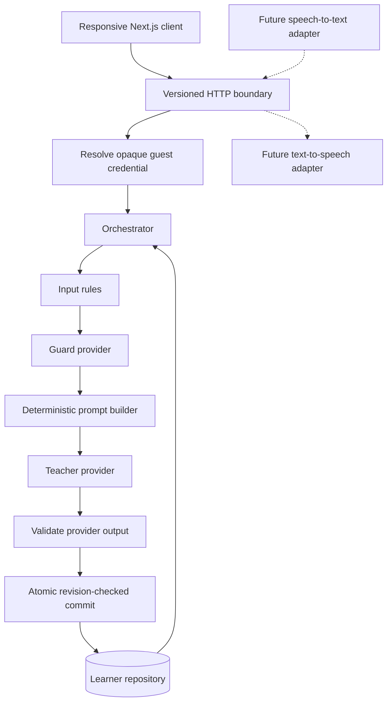

# Architecture and decisions

## Scope

The plan calls for speaking-first practice and a three-layer agent loop. The present request prioritizes a strong framework over feature breadth. The application therefore implements the stateful loop now, using deterministic provider adapters so its correctness can be reviewed without external access. It does not claim to validate the plan's audio latency or learning-effectiveness assumptions.

## Boundaries

- `domain/` has no Next.js, filesystem, database, credentials, or vendor SDK dependencies. Zod defines input and output contracts.
- `server/http/` owns transport, bounded JSON parsing, guest credential resolution, same-origin checks, and safe errors.
- `server/orchestrator.ts` owns lesson transitions, progression policy, memory compression, usage, and persistence. No provider has write authority.
- `domain/prompt.ts` constructs a fresh, detached context. It excludes display names, cookies, owner keys, receipts, and unrelated lessons.
- `server/providers/` implements inference. The demo guard is a heuristic classifier, not a semantic safety model. The demo teacher returns authored prompts, not generated feedback.
- `server/storage/` implements a replaceable repository. `container.ts` is the only place that wires concrete adapters into the application.
- Browser components receive serializable snapshots and submit intent; they never supply trusted progress or model instructions.

## Deployment path

The app supports either the default root path or a configured `NEXT_PUBLIC_BASE_PATH`, currently `/melissa` on the HTTPS server preview. Set the same base path when building and running: Next.js uses it for pages and assets, and the browser API client prefixes its versioned endpoints with it. A reverse proxy preserves the full path when forwarding requests.

`APP_ORIGIN` remains the browser origin without a path, such as `https://hermoscare.com`. Mounting the app under `/melissa` does not change the domain contracts, endpoint suffixes, or stored learner records. Run both root-path and subpath browser flows after changing routing. See [operations](operations.md#server-preview) for the build and proxy setup.

## Turn transaction

1. Validate text and request ID; reject unsupported control delimiters.
2. Load state using the server-derived owner key. Find the session only within that owner's data.
3. Check replay receipts before checking revision. Reusing an ID with different text is a conflict.
4. Check expected revision, session status, turn limit, profile, and daily allowance.
5. Classify intent, calculate proposed participation changes, and build a bounded context on a detached state copy.
6. Call the teacher with a timeout and abort signal. Validate its output. Any failure discards the proposed state.
7. Append the message pair and receipt, compress memory, record latency/activity, and update usage.
8. Atomically update the complete learner aggregate only if its persisted revision still matches. A conflicting writer gets HTTP 409; no partial turn or partial charge is stored.

Concurrent requests can both perform inference before one loses the commit race. This is acceptable for zero-cost demo providers. A paid provider needs durable request reservations and per-learner leases before inference; the current CAS protects data integrity, not external spending.

## State and progress

A learner aggregate contains profile, session snapshots, usage, a data schema version, and a monotonic revision. There is at most one active session. A lesson's level and objectives are copied at creation so editing preferences does not rewrite history.

An eligible demo turn (at least three whitespace-separated words, classified as practice) marks the current objective **tried**. This is explicitly participation, not semantic correctness, mastery, pronunciation quality, or CEFR assessment. Help and redirects do not advance it. A zero-turn session can be closed but is excluded from the finished-practice count.

Active time is the sum of the intervals before submitted turns, each capped at 120 seconds. It is not microphone time and does not count time after the last message. The daily minute preference is a user target, not a timer or enforced lesson duration.

## Memory and boundedness

- Only the latest 12 raw messages enter the teacher's working context.
- Compressed memory contains practiced objective IDs, redirect counts, and the number of archived messages. No raw user-authored instructions enter this summary.
- The complete recent message window is stored; older message pairs are removed. The UI explains this.
- Retry receipts retain learner text for every submitted turn in the session, up to 40 turns. They are never sent to the teacher. Export includes them; it is not a complete archived transcript of teacher replies.
- Each guest can store up to 100 sessions. The preview returns a clear limit error instead of silently deleting history.
- Daily usage is an explicit demo meter (`ceil(input characters / 4) + 100` per committed turn), resetting by UTC date. It does not represent actual tokenization or provider charges.

## Storage decision

SQLite lets the foundation work without PostgreSQL credentials, containers, or a database service. WAL mode, prepared statements, a busy timeout, ordered transactional migrations, expiry checks, and atomic compare-and-swap updates provide useful real persistence behavior.

Node's synchronous SQLite API is appropriate for this bounded local preview. Its experimental Node 24 status and event-loop blocking are confined to one adapter. Use PostgreSQL with an asynchronous repository for hosted scale; do not put SQLite on ephemeral serverless disks, share the WAL file over a network filesystem, or run it at the edge.

The repository is intentionally an aggregate interface. A PostgreSQL adapter may initially store the same versioned JSON aggregate, then normalize sessions and usage in a migration without changing the teaching provider contract. Keep optimistic concurrency and ownership constraints in SQL, not only application code.

## Identity and security limits

A cryptographically random 256-bit token is kept in an HttpOnly, SameSite=Strict cookie. Only its SHA-256 hash is stored in SQLite. Tokens and rows expire 30 days after creation. The demo has no real account, refresh-token rotation, recovery, or cross-device sync.

All unsafe methods require the configured exact origin; clients cannot send an owner ID to select someone else's data. Request bodies are limited to 16 KiB even without Content-Length. Profile and message lengths are bounded; unknown JSON fields are rejected. React renders user messages as plain text. Error logs omit prompts, messages, tokens, profile fields and raw exception messages.

Input regexes and prompt separation are defense in depth, not proof against prompt injection. Semantic guard evaluation and adversarial tests must accompany any real model. There are no model tools, raw database tools, or executable learner content in this implementation.

## Verified implementation references

- [Next.js route handlers](https://nextjs.org/docs/app/getting-started/route-handlers) for the App Router transport boundary.
- [Next.js cookies](https://nextjs.org/docs/app/api-reference/functions/cookies) for cookie behavior in the App Router.
- [Node.js SQLite documentation](https://nodejs.org/docs/latest-v24.x/api/sqlite.html) for the isolated Node 24 persistence adapter.
