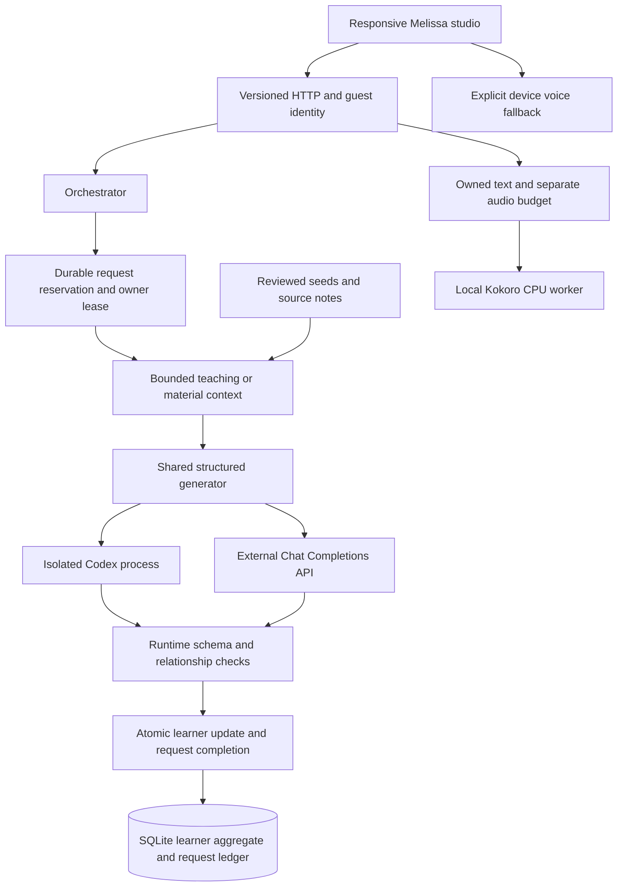

# Architecture and decisions

## Current scope

Melissa now supports real text tutoring and custom lesson generation through either an external OpenAI-compatible API or a local authenticated Codex CLI. An explicit offline `demo` mode remains for development and credential-free tests. The application includes a persistent lesson library, reading and exercises, guided conversation, progress, an illustrated Melissa character, and optional Kokoro or device read-aloud.

The original plan's speaking-first experience is still a direction, not a completed voice product. Microphone input, transcription, formal proficiency assessment, accounts, and payments are not implemented. A dedicated self-hosted Kokoro voice is available as an optional TTS integration.

## Boundaries

- `domain/` defines provider-independent models, validation, participation rules, and prompt construction. It has no Next.js, filesystem, credentials, or database dependency.
- `server/http/` handles bounded JSON, opaque guest credentials, exact-origin checks, routing, and safe errors.
- `server/orchestrator.ts` owns state transitions, replay handling, lesson/library limits, memory compression, and persistence. Providers cannot write learner state.
- `server/inference/` reserves live requests before inference, serializes owner mutations, records reported usage, and coordinates atomic completion. Billing identifiers stay outside prompts through an async execution context.
- `server/providers/` contains the shared `StructuredGenerator`, two real transports, `AiTeacher`, and explicit demo adapters. The current guard remains a deterministic intent heuristic; it is not a semantic moderation or assessment model.
- `server/learning/` retrieves teaching context and builds complete learning materials. `content/learning/` contains the reviewed authoring collection.
- `server/storage/` owns SQLite and ordered migrations. `container.ts` wires adapters and applies metering to the one shared generator used by tutoring and material generation.
- Browser components render serializable snapshots and submit intent. Character assets and typography live in `public/`; branding does not participate in orchestration.

## Live inference transaction

1. Validate the input and request ID; resolve the owner from the guest credential and load that owner's state.
2. Check saved turn receipts or material request IDs before revision checks. A matching successful replay returns saved work without another model call; reusing an ID for different content is a conflict.
3. Validate expected revision, profile, session/library limits, and operation prerequisites.
4. Under `BEGIN IMMEDIATE`, recheck owner/revision, detect previous attempts, enforce guest and global UTC request allowances, and reserve an owner lease. Commit this short transaction before making any network call.
5. Classify intent where needed and construct bounded context. The teacher sees the objective the learner is actually attempting, before participation advances. Generate and validate output with abort/deadline handling.
6. Record reported token counts and an optional upstream request identifier. Missing or uncertain usage remains explicitly marked unknown; it is not treated as evidence of zero charges.
7. In one final SQLite transaction, verify the live lease, apply the learner revision-checked update, save replay evidence, and mark the request completed. Participation, messages, materials, and request completion commit together.

Non-inference mutations—preferences, starting/finishing practice, and deletion—use `withIdle`, which checks the same owner lease and performs the synchronous mutation within one transaction. This closes the race between checking a lease and writing through another process. These callbacks must remain synchronous; no transaction is held across inference.

Failed and interrupted attempts retain their allowance entry because the application cannot prove an upstream service did not charge. The application does not automatically retry an uncertain model call. A successful request whose HTTP response was lost is recovered through saved state. A failed or unrecoverable attempt requires an explicit new send with a new request ID. The ledger stores request metadata and fingerprints, not a second copy of prompts or generated text.

Demo mode uses a separate deterministic practice-unit meter and does not reserve external inference. Its CAS still prevents partial state commits, but its behavior is not evidence about paid model usage.

## Materials and knowledge

The authoring collection contains twelve original scenarios across everyday, travel, and work, original writing guidance for A1–C2, and a source catalog. The catalog includes Melissa's original material, short reviewed factual notes from three external sources, and a CEFR reference link excluded from generation. Full third-party pages, textbooks, and media are not bundled or fetched at request time.

Retrieval filters by goal, then ranks seeds by topic terms and distance from the requested level. It supplies one seed, relevant source notes, and level guidance to generation. This is a small deterministic retrieval layer, not a vector database or an exhaustive syllabus.

A generated material contains a reading, dialogue, vocabulary, exercises with explanations, and exactly three conversation objectives. Shape validation is followed by checks for distinct IDs/terms/options and valid answer indexes. These checks catch structural mistakes; they cannot establish that every generated answer or explanation is correct. The writer is prompted to solve its exercises, and human content review remains necessary.

Materials retain their provider, level, topic, request ID, creation time, and source IDs. Their content is copied into a practice session so later preference changes do not rewrite that session. Source IDs identify material supplied to generation; they are not automatic verification of every generated claim. See [the authoring collection](../content/learning/README.md).

## State, progress, and bounds

A learner aggregate holds profile, sessions, generated materials, demo usage, a data schema version, and a monotonic revision. Released aggregates without `materials` are read with an empty collection, preserving existing identity and history. Only one practice session can be active.

A practice-classified turn with at least three whitespace-separated words marks an objective **tried** after a valid response. This applies to both live and demo modes and remains a participation measure, not correctness, mastery, pronunciation quality, or CEFR assessment. Help and redirects do not advance it. Closing a zero-turn session does not count as finished practice.

- The teacher receives at most twelve recent raw messages. Derived memory contains objective IDs, redirect counts, and archived-message counts, never learner-authored instructions.
- Recent message storage is also bounded to twelve messages. Receipts retain the learner's submitted text for up to forty turns per session, so export is not a complete historical transcript of assistant replies.
- Each guest can retain up to one hundred sessions and thirty custom materials. Limits produce explicit errors rather than silent deletion.
- Active time sums intervals before submitted turns, each capped at 120 seconds. It is not microphone time; daily minutes are a preference rather than a timed lesson guarantee.
- Live request allowances default to sixty per guest and three hundred globally per UTC day. Process-local inference concurrency defaults to two. Counts, reported tokens, and unknown usage are separate from billing or currency.
- Transports cap inputs and output bytes; API completion tokens, Codex subprocess output, and wall-clock execution have additional bounds. See [provider details](ai-providers.md).

## Storage and identity

SQLite provides local durable storage without another service. WAL mode, prepared statements, a busy timeout, ordered transactional migrations, foreign keys, expiry checks, and revision-checked writes are confined to the server adapter. Inference reservations and aggregate updates share the same connection and transaction boundary. No database transaction remains open while waiting for a model.

A 256-bit guest token lives in an HttpOnly, SameSite=Strict cookie, with Secure enabled for HTTPS. Only its SHA-256 hash is stored. Tokens expire thirty days after creation. Repository access prunes expired learners at most once per minute; deletion or expiry removes personal request metadata while retaining anonymous same-day allowance entries to prevent resetting the global allowance by deleting data. Older anonymous entries are removed during pruning.

There are no accounts, recovery, refresh-token rotation, or cross-device identity. All unsafe HTTP methods require the exact configured origin, and clients cannot select an owner ID. JSON bodies are limited to 16 KiB; message/profile/topic lengths and unknown fields are validated. React renders learner and generated text without executing it. Logs and public errors omit raw prompts, credentials, and upstream diagnostics.

The external API receives only its explicit request context and has no attached tools. Codex runs with an isolated temporary home/workspace, disabled execution and tool features, and read-only permissions. A live adversarial audit checks runtime diagnostics and a harmless filesystem sentinel independently of the model's reply. Prompt rules and a heuristic guard still do not guarantee perfect teaching relevance or resistance to all content-level manipulation.

For hosted scale, migrate both the aggregate repository and durable inference unit of work to an asynchronous database adapter. Replacing only `LearnerRepository` is insufficient because lease and aggregate commits must stay atomic. Do not deploy this SQLite arrangement on ephemeral serverless disks or network-mounted WAL files.

## Deployment path and speech

The app supports `/` and a configured build-time/runtime `NEXT_PUBLIC_BASE_PATH`, currently `/melissa` on the HTTPS preview. Pages, assets, and versioned API calls use the same prefix; the proxy preserves it. `APP_ORIGIN` remains the origin without a path. See [operations](operations.md).

Read-aloud uses the configured Kokoro worker or device speech after a user gesture. The server verifies owned text, reserves separate durable audio allowance, and validates the complete WAV before playback. No lesson revision changes. The shared client player supports cancellation, mobile playback gestures, and an explicit device fallback; long readings are split into bounded passages. See [audio boundaries](audio.md). Microphone access remains disabled. Text and synthesis timings do not establish the original plan's complete speech-to-speech latency target.
